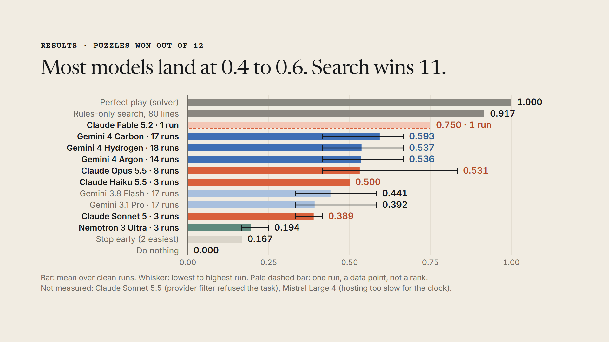
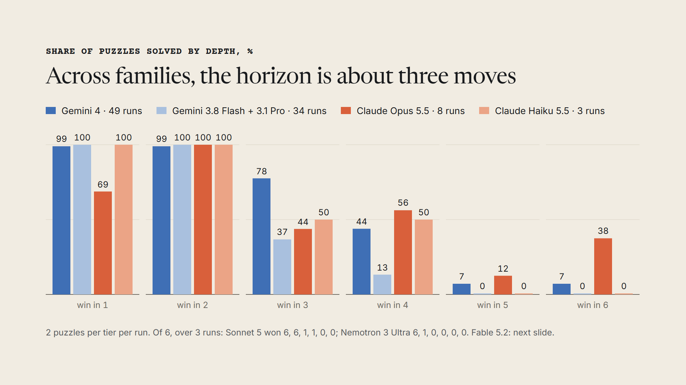
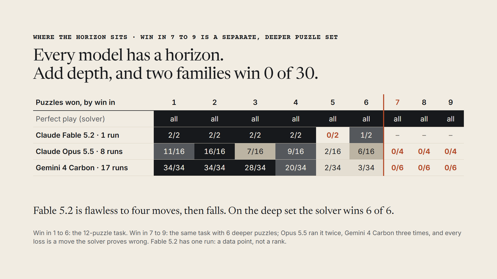
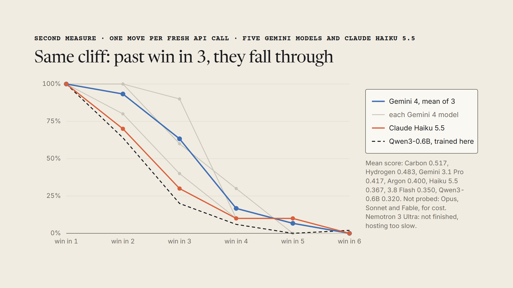
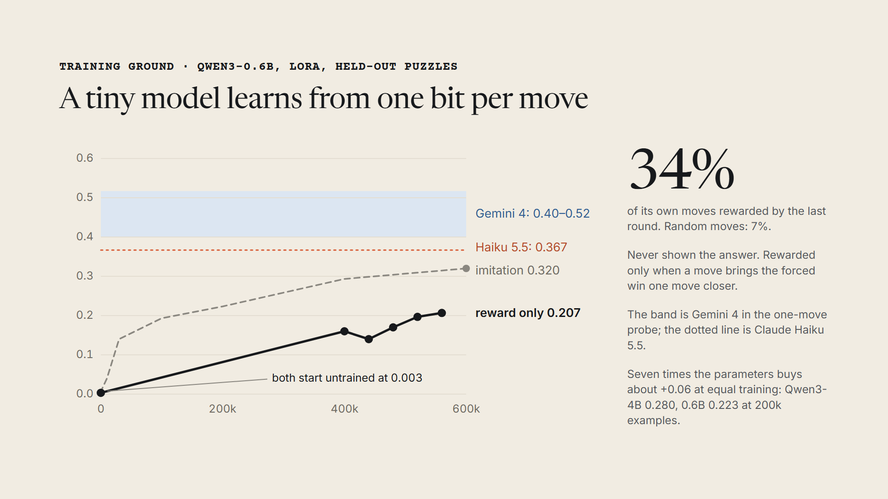

# Thin Ice

Thin Ice is a fully solved reinforcement-learning environment, not a benchmark with a judge. We invented a small board game, solved all 16.5 billion positions by exhaustive retrograde analysis, and built 12 puzzles with exact verdicts: every move is provably right or wrong, the reward is puzzles won / 12, and there is no partial credit. The agent has no shell and cannot run code, so the planning has to happen in its own reasoning.

What came out: the models we tried plan about three moves ahead. Ask for five and they usually fall through: Gemini 4 won 14 of 196 puzzles that were five or six moves deep.

You can [watch every game, or play the puzzles yourself](https://hectoragofi.github.io/thin-ice-replays/). There is also a [two-minute video](demo/thin-ice-demo.mp4) and a [short deck (PDF)](demo/thin-ice-deck.pdf) ([PPTX](demo/thin-ice-deck.pptx)) that I would recommend reading, as it presents everything nicely.

## The game

- 7 columns by 6 rows. Blue and Red have 4 stones each and take turns moving one.
- A stone slides in one of 8 directions and cannot stop early. It stops on the last empty cell before the edge or before another stone. It moves like the queen in chess, but it can't take a piece.
- Three of your stones in a row wins. If you cannot move, you lose.

That is the whole rulebook. Forced wins still run up to 63 moves deep, and in most of our puzzles exactly one move keeps the win. Hence the name.

## The task

It is a standard [Harbor](https://github.com/laude-institute/harbor) task, run with the stock OpenCode agent with a permission config: no shell, no file writing, no web.

The agent plays Blue in 12 puzzles: two each where the win is 1, 2, 3, 4, 5 and 6 moves away. Red is the solver and always picks the longest defence. A puzzle is lost at the first move after which the win is no longer forced, and there is no undo. The agent gets one move more than the puzzle needs.

It talks to a game server through seven tools (`rules`, `list_puzzles`, `show_puzzle`, `play_move`, `save_note`, `skip_puzzle`, `new_practice_puzzle`) and has nothing else. Every reply shows the board, the legal moves, the moves and time left, and Red's answer. Puzzles come one at a time. Each has its own clock, 2 minutes per move of its forced win, so one hard puzzle cannot eat the run. Practice puzzles are free, never count, and tell you the winning move when you get one wrong.

The score is puzzles won divided by 12.

## Results

Same task for every model, 90 minutes per run, 101 runs in total.

| | score (mean) | runs |
|---|---|---|
| Perfect play, moves from the solver | 1.000 | |
| 80 lines of Python that search with only the rules, 20 s per puzzle | 0.917 | |
| Claude Fable 5.2 | 0.750 | 1 |
| Gemini 4 Carbon | 0.593 | 17 |
| Gemini 4 Hydrogen | 0.537 | 18 |
| Gemini 4 Argon | 0.536 | 14 |
| Claude Opus 5.5 | 0.531 | 8 |
| Claude Haiku 5.5 | 0.500 | 3 |
| Gemini 3.8 Flash | 0.441 | 17 |
| Gemini 3.1 Pro | 0.392 | 17 |
| Claude Sonnet 5 | 0.389 | 3 |
| Nemotron 3 Ultra | 0.194 | 3 |
| Stop after the two easiest puzzles | 0.167 | |
| Do nothing | 0.000 | |

(The number of runs is inconsistent due to different access to frontier models.)



The scores hide the real pattern, which is depth. Puzzles won, by how many moves away the win is:

| win in | 1 | 2 | 3 | 4 | 5 | 6 |
|---|---|---|---|---|---|---|
| Gemini 4, 49 runs | 97/98 | 97/98 | 76/98 | 43/98 | 7/98 | 7/98 |
| Claude Opus 5.5, 8 runs | 11/16 | 16/16 | 7/16 | 9/16 | 2/16 | 6/16 |
| Claude Fable 5.2, 1 run | 2/2 | 2/2 | 2/2 | 2/2 | 0/2 | 1/2 |
| Claude Haiku 5.5, 3 runs | 6/6 | 6/6 | 3/6 | 3/6 | 0/6 | 0/6 |





Things we checked before believing this:

- It is not the clock. Of the 616 puzzles lost across all runs, 579 were lost to a move the solver proves wrong. Ten ran out of time.
- Thinking harder helps a little. With reasoning effort set to high, Carbon and Opus both win 11 of 12 puzzles that are 3 or 4 moves away. At 5 and 6 moves they win 0 and 1 of 12.
- Price does not buy reliability. Haiku 5.5 costs about 13 cents a run and scored 0.500; Opus 5.5 costs about $3.30 and scored 0.531, and lost the win-in-one puzzle in 5 of its 8 runs. Opus does reach deeper when it works: 8 of 32 at win in 5–6 versus 0 of 6 for Haiku (even though this comparison is not completely fair due to the different number of attempts), so the difference is consistency, not horizon.
- We built a harder set with wins 7, 8 and 9 moves away. Opus and Carbon won 0 of 30. The solver won all of them.

Twelve puzzles cannot rank models that are close. One puzzle is worth 0.083 and a single model's runs spread from 0.417 to 0.833. Carbon is probably ahead of Argon and Hydrogen. Fable's 0.750 is one run. Sonnet 5.5 has no score because its provider's safety filter refused the task.

Everything else, including how runs were excluded, how each model lost and a second measurement with one move per API call, is in [docs/results.md](docs/results.md).



## Run it

You need Harbor (`uv tool install harbor`) and Docker. Modal works too with `--env modal`. We ran it both ways and got the same reference scores.

```bash
git clone https://github.com/hectoragofi/thin-ice && cd thin-ice

# references and baselines, no API key needed
python scripts/evaluate.py

# the same plus 3 runs of a model, one table at the end
export GEMINI_API_KEY=...            # or OPENAI_API_KEY / ANTHROPIC_API_KEY
python scripts/evaluate.py --model google/gemini-4-carbon
```

Or one run at a time through Harbor:

```bash
harbor run -p task -a oracle                              # perfect play, 1.000
harbor run -p task -a oracle --ae SOLUTION=search         # rules-only search, 0.917
harbor run -p task -a nop                                 # do nothing, 0.000
harbor run -p task -a oracle --ae STOP_AFTER=2            # stop early, 0.167
harbor run -p task -a opencode -m <provider>/<model>      # an agent
THINICE_SEED=7 harbor run -p task -a oracle               # a different draw of 12 puzzles
```

The first run on a clean machine takes one to three minutes because it builds two images. After that a reference run takes about 40 seconds. A model run costs whatever the model costs: roughly 13 cents for Haiku 5.5, 2 to 4 dollars for Opus 5.5 and 2.60 to 5 dollars for the Gemini 4 models, going by the harness's own estimates for our runs.

## Can the score be gamed?

We tried. `tools/redteam.py` runs 96 attacks against a live game server and 13 more against the clock, and none of them changes the score.

The short version of why: the puzzles, the opponent and the answers live in a separate container. The agent's container has no game code or data in it, and the agent has no tool that can write a file or run a program. The game server signs the score sheet, and a third container checks the signature. Guessing does not work because the first wrong move ends the puzzle. Doing nothing scores 0 and stopping early scores what you actually won.

The 12 scored puzzles are also proved in Lean 4. For each one Lean checks, with its own copy of the rules, that Blue really has a forced win in the stated number of moves. It also proves that the common wrong move (`c1-g5`) in puzzle 7 loses. Eleven of the twelve are checked by Lean's kernel alone. The twelfth was too big for that and also trusts the Lean compiler.

One gap we know about: someone with a shell inside the agent's container could reconfigure OpenCode by hand and give it a shell. The agent has no shell, so it cannot. The attack list and the fine print on the proofs are in [docs/reward.md](docs/reward.md).

## Can a model learn here?

Practice inside a session does not help. We told Haiku 5.5, Argon and Carbon to play 12 practice puzzles before the scored ones, and their scores moved by about one puzzle at most.

Training does. A Qwen3 model with 0.6 billion parameters, trained on the moves the solver says win, goes from 0.003 to 0.320 on puzzles it never saw. Trained only on a yes or no after each of its own moves, never shown an answer, it gets to 0.207. Those numbers are from a simpler test with one move per call, where Gemini 4 scores 0.40 to 0.52, so they are not really comparable with the table above. A 4B model at the same amount of training is only slightly ahead of the 0.6B. Details in [docs/training.md](docs/training.md).



## Why the agent gets no code

We started with code. On a 5×5 board with a shell, Gemini 4 Carbon wrote its own search and scored 1.000; on 7×6 it did the same. We removed the shell and offered a rules-only look-ahead tool, and every model we tried scored about 1.0 by checking every branch. We budgeted the tool, and Argon still solved all 10 puzzles with fewer lookups than our own reference needed. At that point the tool was doing the planning, so we removed it too. What is left is the model's own look-ahead. That's when it clicked: writing a search is a solved skill, but holding a five-move or longer forced line in the agent's head is not, and it gets confused.

The longer story, including the harness problems we hit, is in [docs/design.md](docs/design.md).

## Key takeaways

- Planning horizon is measurable and stable: models solve 1–3, collapse at 5–6, and it is not the clock.
- More effort fills the middle, not the edge, and more money does not buy reliability.
- In-session practice does not help, but training on the same feedback moves a 0.6B model from 0.003 to 0.320.

